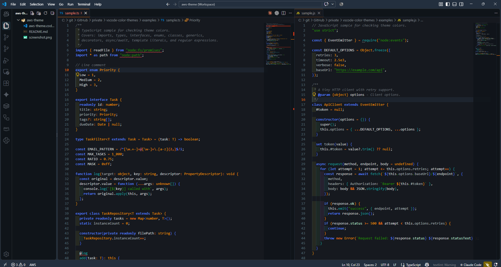

# vscode-color-themes

[](./LICENSE)

*他の言語で読む(Read this in other languages):* [](./README.ja.md) [](./README.md)

## 概要

個人利用・比較・アイデア出しのための VS Code カラーテーマ集です。

各テーマは `.code-workspace` ファイルとして提供しており、`workbench.colorCustomizations`（UI の配色）と `editor.tokenColorCustomizations`（シンタックスハイライトの配色）を定義しています。Marketplace から拡張機能をインストールする必要はなく、ワークスペースファイルを開くだけでそのウィンドウにだけテーマが適用されます。ユーザー設定やプロジェクトの `.vscode/settings.json` には影響しません。

[`examples/`](./examples/) には言語ごとのサンプルソースコードとテキストを用意しているので、テーマを使う前に配色を確認できます。

## テーマ一覧

| テーマ | 系統 | 説明 | スクリーンショット |
| --- | --- | --- | --- |
| [aws-theme](./themes/aws-theme/) | ダーク | AWS マネジメントコンソール風。ネイビーの UI にオレンジのアクセント。 |  |

カラーパレットや詳しい使い方は、各テーマディレクトリの `README.md` を参照してください。

## ディレクトリ構成

```text
vscode-color-themes/
├── themes/                          # テーマごとに 1 ディレクトリ
│   └── <theme-name>/
│       ├── README.md                # テーマの説明・パレット・使い方
│       ├── <theme-name>.code-workspace
│       └── screenshot.png           # プレビュー画像
├── examples/                        # 配色確認用のサンプルファイル
│   ├── README.md
│   ├── sample.ts
│   ├── sample.py
│   └── ...
├── LICENSE
├── README.md
└── README.ja.md
```

## 使い方

### プロジェクトにテーマを適用する

1. `themes/<theme-name>/<theme-name>.code-workspace` を、使いたいプロジェクトのルートにコピーします。
2. **ファイル > ファイルでワークスペースを開く...**（File > Open Workspace from File...）で開きます。ダブルクリックでも開けます。
3. そのウィンドウにテーマが適用されます。普段のテーマに戻したいときは、ワークスペースファイルではなくプロジェクトフォルダを直接開いてください。

ワークスペースファイルには `"folders": [{ "path": "." }]` と書かれているため、ファイルを置いたフォルダがそのまま開きます。

### そのほかの適用方法

- **プロファイル**: **Profiles: Create Profile** でプロファイルを作り、ワークスペースファイルの `settings` ブロックの中身をプロファイルの `settings.json` にコピーします。プロファイルを切り替えるだけでテーマも切り替わります。
- **ユーザー設定**: `settings` ブロックをユーザーの `settings.json` にコピーすると、すべてのウィンドウでテーマが使えます。

> [!TIP]
> これらのテーマは、選択中のカラーテーマ（`workbench.colorTheme`）の上に色を上書きする仕組みです。テーマで定義していないトークンや UI の色はベースのテーマの色になります。ダーク系のテーマは **Dark Modern** などダーク系のベーステーマと組み合わせてください。

## examples で配色を確認する

1. `themes/<theme-name>/<theme-name>.code-workspace` を VS Code で開きます。
2. **ファイル > ファイルを開く...** で [`examples/`](./examples/) 内のファイルを開きます。

ワークスペースの配色設定はウィンドウ全体に効くため、ワークスペースフォルダの外にあるファイルもテーマの色で表示されます。テーマを比べたいときは、それぞれのワークスペースを別ウィンドウで開き、同じサンプルファイルを並べて表示してください。

## テーマを追加する

### 手順

1. `themes/<theme-name>/` を作成します。ディレクトリ名はケバブケースにします。
2. `<theme-name>.code-workspace` を作成し、`"folders": [{ "path": "." }]` を指定したうえで、`settings` に配色設定を書きます。
3. `README.md` を追加します（[テーマの README](#テーマの-readme) を参照）。
4. `examples/` のファイルを開いて配色を確認します。足りない言語があればサンプルを追加してください。
5. スクリーンショットを撮り、`screenshot.png` として保存します（[スクリーンショット](#スクリーンショット) を参照）。
6. `README.md` と `README.ja.md` の両方の「テーマ一覧」にテーマを追記します。

### ルール

#### ベーステーマ

ワークスペースファイルでは `workbench.colorTheme` を指定しません。ベーステーマは利用者が選べるようにし、推奨するベーステーマ（例: **Dark Modern**）をテーマの README に書きます。

#### 必ず定義する色

見え方がベーステーマに左右されないよう、最低限次の色を定義します。

- **UI**（`workbench.colorCustomizations`）: エディタの背景・文字色、行番号、カーソル、選択範囲、現在行のハイライト（`editor.lineHighlightBackground` と `editor.lineHighlightBorder`）、単語のハイライト、括弧のペア色（`editorBracketHighlight.*`）、インデントガイド、ウィジェット（補完・ホバー）、サイドバー、アクティビティバー、タイトルバー、ステータスバー、タブ、パネル、ターミナル（背景・文字色・ANSI 16 色すべて）
- **トークン**（`editor.tokenColorCustomizations`）: コメント、文字列、数値、定数、キーワード、演算子、関数、クラス・型、変数、引数、プロパティ。ベーステーマの斜体や下線が残らないよう、`fontStyle` も明示します（なしにする場合は `""`）。ベーステーマが `variable.parameter` や `support.type.primitive` のように細かいスコープを指定しているとそちらが優先されるため、細かいスコープも列挙します。

#### コントラスト

エディタ背景に対するコントラスト比を確認します。

- 文字色と主要なトークン（キーワード、関数、型、変数など）: **4.5:1 以上**を目安にする（WCAG AA）
- 控えめに見せる色（コメント、行番号、非アクティブな項目）: **3:1 以上**

#### テーマの README

各テーマの `README.md` には次の見出しを用意します。

1. 概要: コンセプトと系統（ダーク / ライト）
2. スクリーンショット
3. カラーパレット: 主な色と用途の表
4. 推奨ベーステーマ
5. 適用方法
6. `examples/` での配色確認

[themes/aws-theme/README.md](./themes/aws-theme/README.md) をテンプレートとして使えます。

#### スクリーンショット

- ファイル: `themes/<theme-name>/screenshot.png`
- 内容: [`examples/sample.ts`](./examples/sample.ts) を開き、タイトルバー、アクティビティバー、サイドバー（エクスプローラー）、タブ、ステータスバーが映った状態。ターミナルパネルは任意
- サイズ: 全画面表示（1280×800 px 以上）
- ユーザー名やローカルのパスなどの個人情報を映さない（ターミナルのプロンプトなど）

エディタ上部のパンくずリストに表示されるファイルのパスを隠したいときは、撮影する間だけパンくずリストをオフにします。

1. コマンドパレット（`Ctrl+Shift+P` / `Cmd+Shift+P`）で **View: Toggle Breadcrumbs** を実行します。`settings.json` に `"breadcrumbs.enabled": false` を書いても同じです。
2. スクリーンショットを撮ります。
3. もう一度 **View: Toggle Breadcrumbs** を実行する（または設定を削除する）と、パンくずリストが元に戻ります。

## ライセンス

[MIT License](./LICENSE)
