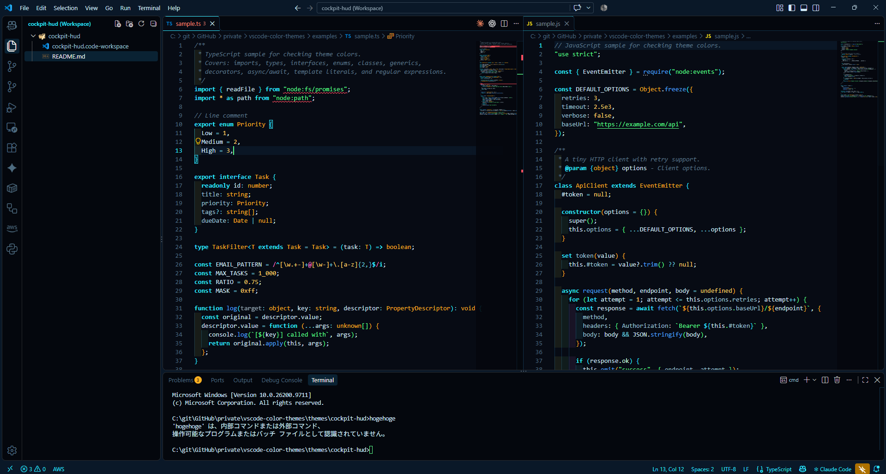

# コックピットHUD風カラーテーマ

## 概要

『機動戦士ガンダムSEED』シリーズに登場する、全天周モニターのコックピットから着想を得たダークテーマです。

- 宇宙が映るモニター → ほぼ黒に近い深い紺の背景
- モニターに重ねて表示される HUD → シアンの枠線とアクセント
- 照準 → 緑のカーソルと文字列
- バッテリー残量計・警告表示 → アンバー（型名・注意）と赤（エラー）

非公式のファンメイドで、作品の権利者とは関係ありません。配色は作中の設定資料に基づくものではなく、イメージから組み立てたものです。

## スクリーンショット

## カラーパレット

| 色 | 用途 |
| --- | --- |
| `#070b14` | エディタ背景、アクティブタブ |
| `#04070d` | サイドバー・アクティビティバー・パネル・ターミナル背景 |
| `#0a1828` | タイトルバー・ステータスバー |
| `#12324a` / `#1b3a52` | 各種ボーダー、インデントガイド |
| `#134a6b` | 選択範囲、リストの選択 |
| `#cfe8f5` | 基本の文字色、変数、引数 |
| `#9fc3d6` | プロパティ、サイドバーの文字 |
| `#2ee6ff` | メインのアクセント（HUD のシアン）、キーワード（太字）、HTML タグ、見出し |
| `#67c7dd` | 演算子 |
| `#5cff8a` | 文字列、カーソル、Git の未追跡ファイル |
| `#4da3ff` | 関数名、属性名、JSON のキー、リンク |
| `#ffb020` | クラス・型名、警告、検索ヒット、Git の変更 |
| `#ffd166` | 数値・定数 |
| `#b48cff` | import・名前空間、Git の競合 |
| `#ff7ac6` | 正規表現 |
| `#ff4d5e` | エラー、不正なコード（取り消し線）、Git の削除 |
| `#5d7a8c` | コメント（斜体） |
| `#4d6b80` | 行番号、非アクティブなタブ・アイコン |

エディタ背景 `#070b14` に対するコントラスト比は、文字色と主要なトークンが 6:1 以上、コメントが 4.34:1、行番号が 3.50:1 です。

## 推奨ベーステーマ

ベースのカラーテーマ（`workbench.colorTheme`）は指定していないため、**Dark Modern** などダーク系のテーマと組み合わせて使ってください。このテーマで定義していない色は、ベーステーマの色になります。

## テーマを適用する方法

### 方法1: ワークスペースファイルを使う（推奨）

1. `cockpit-hud.code-workspace` を、使いたいプロジェクトのルートにコピーする
2. `cockpit-hud.code-workspace` をダブルクリックするか、**ファイル > ファイルでワークスペースを開く...** で開く
3. VSCode がコックピットHUD風カラーテーマで起動します

ワークスペースファイルは `"folders": [{ "path": "." }]` となっているため、ファイルを置いたフォルダがそのまま開きます。普段のテーマに戻したいときは、プロジェクトフォルダを直接開いてください。

### 方法2: プロファイルを使う（VSCode 1.75以降）

1. `Ctrl+Shift+P` (Mac: `Cmd+Shift+P`)
2. 「Profiles: Create Profile」を選択
3. プロファイル名を「Cockpit HUD」にする
4. `cockpit-hud.code-workspace` の `settings` ブロックの中身を、このプロファイルの `settings.json` にコピー

### 方法3: ユーザー設定に直接書く

1. `Ctrl+Shift+P` (Mac: `Cmd+Shift+P`)
2. 「Preferences: Open User Settings (JSON)」を選択
3. `cockpit-hud.code-workspace` の `settings` ブロックの中身を貼り付ける

## 配色を確認する

このリポジトリの [`examples/`](../../examples/) に、言語ごとのサンプルファイルがあります。

1. このディレクトリの `cockpit-hud.code-workspace` を開く
2. **ファイル > ファイルを開く...** で `examples/` 内のファイルを開く
